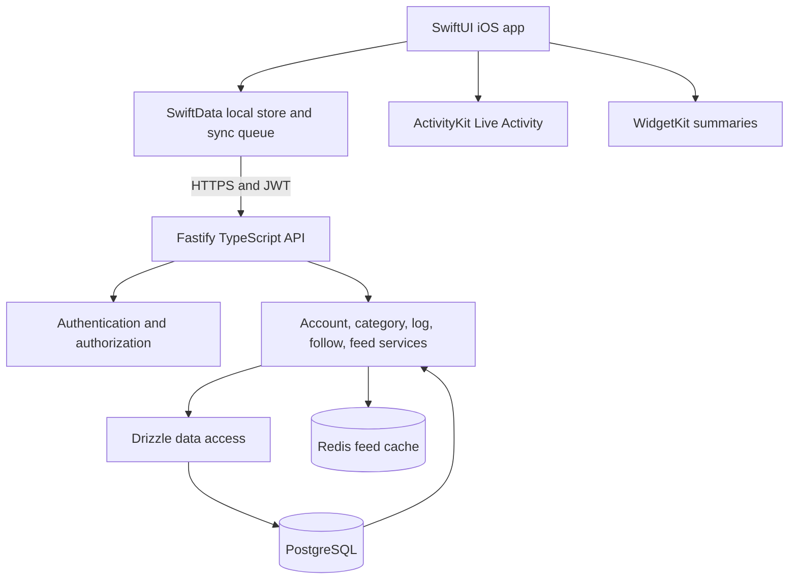

# Design Document: Social Time Tracker

## Overview

The Social Time Tracker consists of a native iOS application and a TypeScript/Fastify API. The iOS application owns timer interaction and local-first persistence. The API owns account identity, authorization, durable activity data, follow relationships, and feed delivery. PostgreSQL provides relational integrity. Redis is an expendable feed-distribution cache; PostgreSQL remains the source of truth.

The iOS client starts and stops timers using persisted timestamps, then queues completed logs locally until the API acknowledges them. Each log carries a stable client-generated idempotency key. The API uses a unique database constraint and transactional inserts so retries return the original log rather than creating another one. Authentication uses username/password credentials and signed JWTs, not Supabase Auth. This design covers the full target platform, although the current repository only contains a minimal Fastify service.

## Architecture



The API is divided into route plugins, validation schemas, domain services, and repositories. Route handlers authenticate requests, parse runtime-validated payloads, invoke services, and serialize stable responses. Services enforce ownership and visibility rules. Repositories use Drizzle transactions for relational writes. Redis may accelerate feed candidate lookup, but cache misses and stale entries fall back to database queries.

The iOS client separates SwiftUI views from timer state, SwiftData persistence, and network synchronization. ActivityKit and WidgetKit read state derived from the local store. Network availability schedules synchronization, but correctness does not depend on background execution being granted at a particular time: the queue remains persisted and is retried on later opportunities, including application launch.

## Components and Interfaces

### Component 1: Fastify API

**Purpose**: Expose versioned, authenticated HTTP endpoints for the mobile client.

**Interface**:

```typescript
interface ApiRoutes {
  POST_register(request: RegisterRequest): Promise<PublicUser>
  POST_login(request: LoginRequest): Promise<AuthTokens>
  GET_profile(userId: string): Promise<PublicUser>
  POST_logs(userId: string, request: CreateLogRequest): Promise<LogReceipt>
  GET_feed(userId: string, query: FeedQuery): Promise<FeedPage>
}
```

**Responsibilities**:

- Register route plugins under `/api/v1`.
- Validate request and query data at runtime with Zod.
- Attach authenticated user identity through a JWT verification hook.
- Map expected domain errors to structured HTTP status codes.
- Avoid returning secrets, password hashes, or internal stack traces.

### Component 2: Authentication Service

**Purpose**: Register accounts, verify passwords, and issue and validate JWTs.

**Interface**:

```typescript
interface AuthenticationService {
  register(input: RegisterInput): Promise<PublicUser>
  login(input: LoginInput): Promise<AuthTokens>
  verifyToken(token: string): Promise<AuthenticatedUser>
}

type RegisterInput = {
  username: string
  displayName: string
  email: string
  password: string
}

type AuthTokens = {
  accessToken: string
  tokenType: "Bearer"
  expiresInSeconds: number
}
```

**Responsibilities**:

- Normalize identifiers consistently before uniqueness checks.
- Hash passwords with a maintained password-hashing algorithm and per-password salt.
- Use a configured JWT signing secret and expiration.
- Return only public profile fields from account operations.
- Apply login rate limits at the HTTP boundary before production deployment.

### Component 3: Activity Log Service

**Purpose**: Validate ownership, enforce idempotency, and persist completed activity logs.

**Interface**:

```typescript
interface ActivityLogService {
  create(userId: string, input: CreateLogRequest): Promise<LogReceipt>
  listVisible(userId: string, ids: string[]): Promise<FeedEntry[]>
}

type CreateLogRequest = {
  idempotencyKey: string
  title: string
  notes?: string
  startedAt: string
  endedAt: string
  categoryIds: string[]
  visibility: "public" | "private" | "friends_only"
}

type LogReceipt = {
  id: string
  idempotencyKey: string
  created: boolean
}
```

**Responsibilities**:

- Validate start and end timestamps and require `endedAt >= startedAt`.
- Verify all selected categories belong to the authenticated user.
- Insert the log and category links within one database transaction.
- Use the unique idempotency-key constraint to resolve concurrent duplicate requests.
- Return the existing record for a repeated key and avoid a second fan-out.
- Add only public logs to follower feed indexes after successful durable commit.

### Component 4: Feed Service

**Purpose**: Return a cursor-paginated feed whose records obey visibility rules.

**Interface**:

```typescript
interface FeedService {
  getPage(userId: string, query: FeedQuery): Promise<FeedPage>
}

type FeedQuery = {
  cursor?: string
  limit: number
}

type FeedPage = {
  items: FeedEntry[]
  nextCursor?: string
}
```

**Responsibilities**:

- Enforce a default page size of 20 and a configured maximum.
- Use a stable compound cursor based on creation timestamp and log ID to avoid pagination gaps for equal timestamps.
- Filter records by follower relationship and visibility before returning hydrated content.
- Use Redis sorted sets as candidate indexes, with database fallback and visibility filtering.
- Treat cache contents as non-authoritative and repair or refresh stale entries asynchronously or during reads.

### Component 5: PostgreSQL Data Layer

**Purpose**: Persist accounts, categories, logs, follows, and category relationships.

**Interface**:

```typescript
interface TrackerRepository {
  createUser(input: NewUser): Promise<UserRecord>
  findUserByLogin(login: string): Promise<UserRecord | undefined>
  findLogByIdempotencyKey(key: string): Promise<LogRecord | undefined>
  createLogWithCategories(userId: string, input: CreateLogRequest): Promise<LogRecord>
  getFeedPage(userId: string, cursor: FeedQuery["cursor"], limit: number): Promise<FeedEntry[]>
}
```

**Responsibilities**:

- Declare schema using Drizzle and checked-in migrations.
- Enforce foreign keys, unique identifiers, and cascading deletion in PostgreSQL.
- Store timestamps with time zone and derive duration from `ended_at - started_at`.
- Keep database transactions short and avoid Redis calls inside database transactions.

### Component 6: iOS Timer and Local Store

**Purpose**: Provide responsive timer operations and durable offline records.

**Interface**:

```swift
protocol TimerStore {
    func start(title: String, notes: String?, categoryIDs: [UUID], visibility: Visibility) async throws -> RunningTimer
    func stop(timerID: UUID, endedAt: Date) async throws -> LocalActivityLog
    func currentTimer() async throws -> RunningTimer?
}

protocol SyncQueue {
    func pendingLogs() async throws -> [LocalActivityLog]
    func markSynced(idempotencyKey: UUID, serverID: UUID) async throws
    func recordAttempt(idempotencyKey: UUID, failure: SyncFailure) async throws
}
```

**Responsibilities**:

- Persist running timer start time and fields in SwiftData.
- Derive elapsed display time from the start date and current time.
- Generate one UUID idempotency key when completing a timer and retain it through all retries.
- Persist sync status and retry metadata with each queued log.
- Reconcile server acknowledgements without removing local data before durable confirmation.

### Component 7: iOS System Surfaces

**Purpose**: Present timer and aggregate activity data outside the main app view.

**Responsibilities**:

- Start and end ActivityKit Live_Activity instances alongside timer state transitions.
- Render elapsed-time context using system-supported date/timer presentation.
- Calculate widget daily and weekly totals from local persisted logs.
- Refresh WidgetKit timelines after relevant local data changes.
- Provide a graceful timer-only experience when Live Activities are unavailable or denied.

## Data Models

### Model 1: User

```typescript
interface UserRecord {
  id: string
  username: string
  displayName: string
  email: string
  passwordHash: string
  avatarUrl: string | null
  createdAt: Date
}
```

**Validation Rules**:

- `id` is the UUID associated with the account identity.
- `username` and normalized `email` are unique.
- `passwordHash` is never included in API response models.
- Password input is bounded by documented minimum and maximum lengths before hashing.

### Model 2: Category

```typescript
interface CategoryRecord {
  id: string
  userId: string
  name: string
  colorHex: string
  createdAt: Date
}
```

**Validation Rules**:

- `userId` references an existing User.
- Category name is unique within a User.
- `colorHex` matches `#RRGGBB`.

### Model 3: Activity Log

```typescript
interface LogRecord {
  id: string
  userId: string
  title: string
  notes: string | null
  startedAt: Date
  endedAt: Date
  durationSeconds: number
  visibility: "public" | "private" | "friends_only"
  idempotencyKey: string
  createdAt: Date
}
```

**Validation Rules**:

- `userId` references an existing User.
- `idempotencyKey` is a unique UUID generated by the client and reused on retries.
- `endedAt` is greater than or equal to `startedAt`.
- `durationSeconds` is generated by PostgreSQL from the timestamps.
- `title` is non-empty and no longer than 100 characters.
- Visibility is one of the three defined values.

### Model 4: Follow and Log Category

```typescript
interface FollowRecord {
  followerId: string
  followingId: string
  createdAt: Date
}

interface LogCategoryRecord {
  logId: string
  categoryId: string
}
```

**Validation Rules**:

- The follow pair is a composite primary key, and follower and following IDs must differ.
- Each log-category pair is unique.
- Both relationship columns reference existing records with cascading deletion.
- Category ownership is verified by the service before links are inserted.

### Model 5: Local Activity Log

```swift
struct LocalActivityLog {
    var id: UUID
    var idempotencyKey: UUID
    var title: String
    var notes: String?
    var startedAt: Date
    var endedAt: Date?
    var categoryIDs: [UUID]
    var visibility: Visibility
    var syncState: SyncState
    var serverID: UUID?
}

enum SyncState {
    case running
    case pending
    case syncing
    case synced
}
```

**Validation Rules**:

- A running record has no `endedAt`; a completed record has `endedAt >= startedAt`.
- The idempotency key is generated exactly once at completion and remains stable for all retries.
- Local persistence must retain records when synchronization fails.

## Correctness Properties

_A property is a characteristic or behavior that should hold true across all valid executions of a system, essentially a formal statement about what the system should do. Properties serve as the bridge between human-readable requirements and machine-verifiable correctness guarantees._

Property assessment: PBT applies to pure validation, duration, cursor, visibility-filtering, and local queue transition logic because varied inputs reveal edge cases. HTTP wiring, database constraints, ActivityKit/WidgetKit behavior, and app lifecycle integration require example-based or integration tests. Related properties are consolidated where one invariant covers multiple acceptance criteria.

### Property 1: Activity Log Input Validation

For all generated activity log payloads, the validator accepts a payload if and only if the required fields, UUID formats, length limits, timestamp ordering, category ID formats, and visibility value meet the documented validation rules.

**Validates: Requirements 5.7, 5.8**

### Property 2: Duration Matches Timestamp Difference

For all valid start and end timestamps where `endedAt >= startedAt`, the derived duration is non-negative and equals the whole-second difference between the timestamps.

**Validates: Requirements 8.5**

### Property 3: Idempotency-Key Retry Stability

For all completed local activity logs without subsequent user edits, any number of retry attempts preserves the original idempotency key and log payload.

**Validates: Requirements 5.3, 10.2, 10.3**

### Property 4: Visibility Filter Excludes Unauthorized Logs

For all candidate feed records and authenticated viewers, the visibility filter includes a record if and only if the viewer is authorized by the record's visibility setting and follow relationship.

**Validates: Requirements 6.5, 6.6, 7.3**

### Property 5: Cursor Pagination Is Ordered and Bounded

For all ordered feed collections and valid cursors, each page contains no more than the bounded requested limit, returns entries older than the cursor in descending feed order, and consecutive pages contain no duplicate entries.

**Validates: Requirements 7.1, 7.2**

### Property 6: Sync Queue Acknowledgement Transitions

For all pending local logs, a successful server acknowledgement marks the log synced and stores its server ID; a failed attempt keeps the log pending without changing its payload or idempotency key.

**Validates: Requirements 5.5, 5.6, 10.3, 10.4**

## Error Handling

### Invalid Request

**Condition**: A payload, timestamp, identifier, visibility value, or pagination parameter fails schema validation.

**Response**: Return HTTP 400 with a stable error code and field-level issue paths. Do not include secrets or stack traces.

**Recovery**: The iOS client retains queued records and surfaces correctable validation errors for user review. Non-correctable version mismatches are logged for diagnosis.

### Authentication Failure

**Condition**: Credentials are invalid, a JWT is missing or invalid, or a JWT has expired.

**Response**: Return HTTP 401 with a generic authentication error. Do not disclose whether a username or password was incorrect.

**Recovery**: The user can retry login. The client refreshes authentication through login because no refresh-token behavior is specified in the current requirements.

### Duplicate Account or Category

**Condition**: A username, email, or per-user category name conflicts with an existing record.

**Response**: Return HTTP 409 with a conflict code that does not disclose another user's sensitive data.

**Recovery**: The caller selects a different value.

### Duplicate Log Submission

**Condition**: A request repeats an idempotency key, including concurrent retries.

**Response**: Return the existing server log ID and indicate that the record was not newly created. The database unique constraint resolves races.

**Recovery**: The iOS client marks the queued record synchronized using the returned server ID.

### Database or Redis Failure

**Condition**: PostgreSQL is unavailable, or Redis cannot serve or update the feed cache.

**Response**: PostgreSQL-dependent writes return HTTP 503 and do not acknowledge success. Redis failures do not invalidate committed log writes; feed reads fall back to PostgreSQL.

**Recovery**: The iOS client keeps unacknowledged records queued. Redis cache data is rebuilt from durable database records.

### Offline or Interrupted Synchronization

**Condition**: Connectivity is absent or a request is interrupted before the client receives a response.

**Response**: Keep the local log and idempotency key in SwiftData. Continue with other queued records after an individual failure.

**Recovery**: Retry on connectivity restoration, application launch, or a permitted background task. Server idempotency makes uncertain outcomes safe to retry.

## Testing Strategy

### Unit Testing Approach

- Use Node.js test runner or Vitest for Zod validation, timestamp/duration calculations, cursor ordering, visibility filtering, service error mapping, and sync-state-independent pure logic.
- Use XCTest for timer state restoration, local queue transitions, widget aggregation, and API payload encoding.
- Cover invalid timestamps, maximum field lengths, unsupported visibility, duplicate categories, empty feed pages, equal feed timestamps, expired tokens, and category ownership failures with example tests.

### Property-Based Testing Approach

- Use `fast-check` for TypeScript pure functions and generated request validation, pagination, duration, visibility filtering, and idempotency state transitions.
- Use SwiftCheck only if its dependency and integration cost are justified; otherwise test Swift state transitions with table-driven XCTest cases.
- Run at least 100 generated cases for each property test and label tests with the feature and property number.
- Keep external service calls out of generated properties. Test database uniqueness and transactions with integration tests.

**Property Test Library**: `fast-check` for TypeScript; XCTest examples for Swift unless a Swift property-test dependency is selected during implementation.

### Integration Testing Approach

- Run Fastify injection tests against a disposable PostgreSQL instance and a Redis instance to verify registration, login, protected routes, log transactions, duplicate idempotency requests, feed pagination, visibility, and cache fallback.
- Verify concurrent submissions with the same idempotency key produce one durable log.
- Verify migration application and service startup with valid and missing configuration.
- Use Xcode simulator/device tests for SwiftData persistence, timer restoration, ActivityKit availability handling, widget refresh, and offline-to-online sync.
- Stub API responses for mobile synchronization tests; retain a smaller end-to-end test against the local API and database.

## Performance Considerations

- Add indexes for user-owned records, idempotency keys, follow lookups, category joins, and descending feed chronology.
- Bound feed page size and batch hydrate log IDs rather than issuing one query per feed entry.
- Keep Redis feed sets capped or pruned according to a configurable retention policy; PostgreSQL remains authoritative for older feed pages.
- Use database-generated durations to keep values consistent across clients.
- iOS timer rendering derives from dates and system timer presentation, avoiding a continuously running process for elapsed-time accuracy.

## Security Considerations

- Hash passwords with Argon2id or an established equivalent and never log passwords, hashes, JWTs, or authorization headers.
- Load JWT signing keys and database credentials from environment configuration or a secret manager in deployment.
- Set short-lived access-token expiry. Refresh-token rotation is not included until token lifecycle requirements are defined.
- Validate all input at runtime and enforce account ownership in service queries, not only in the mobile client.
- Apply rate limits to registration and login, configure TLS at the deployment boundary, and use generic credential failure responses.
- Enforce visibility filters in database-backed service logic before returning feed entries; Redis membership alone is not authorization.
- Avoid logging notes or other potentially sensitive activity content unless explicitly required for diagnostics.

## Dependencies

- Backend: Node.js, TypeScript, Fastify, Zod, Drizzle ORM, PostgreSQL, Redis, an Argon2 implementation, and a JWT library.
- Backend testing: Vitest or Node.js test runner, fast-check, and disposable PostgreSQL/Redis test services.
- iOS: Swift, SwiftUI, SwiftData, ActivityKit, WidgetKit, Network framework, and XCTest.
- Local infrastructure: Docker Compose for PostgreSQL and Redis.
- Authentication: application-managed username/password credentials and JWT signing; Supabase Auth is not used.
